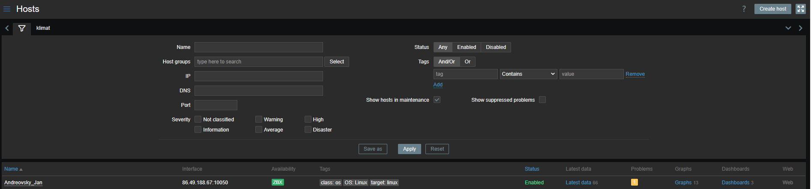
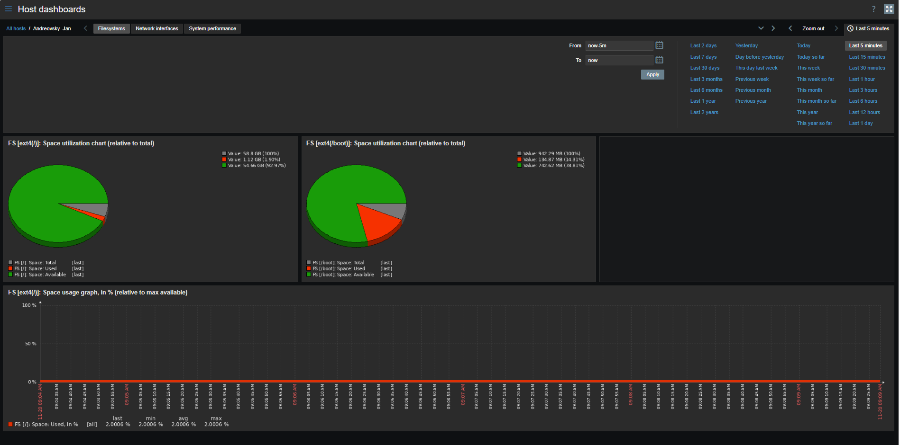

Debian 13 – Vagrant a Zabbix Agent

Popis projektu

Projekt slouží k automatickému vytvoření virtuálního počítače s operačním systémem Debian 13 pomocí nástroje Vagrant a VirtualBox.

Během automatického provisioningu se nainstaluje webový server Apache2 a Zabbix Agent. Následně se provedou potřebné konfigurace služeb a nastavení komunikace se Zabbix serverem.

Zabbix server: enceladus.pfsense.cz

(Zobrazení uživatele v Zabbixu)

Použité technologie

Debian 13

Vagrant

VirtualBox

Zabbix Agent

Konfigurace virtuálního počítače

Virtuální počítač má přiděleny 4 GB operační paměti a 4 procesorová jádra.

Pro přístup ke službám jsou nastaveny následující porty:

Služba

Port

SSH

2206

Automatická instalace a konfigurace

Provisioning provádí následující činnosti:

Aktualizaci systému Debian.

Instalaci Apache2 a Zabbix Agenta.

Aktivaci modulu Apache mod_status.

Konfiguraci stránky server-status.

Nastavení adresy Zabbix serveru.

Nastavení parametrů Server, ServerActive a Hostname.

Povolení automatického spouštění služeb.

Kontrolu funkčnosti Zabbix Agenta.

Spuštění projektu

V kořenovém adresáři projektu otevřeme terminál a spustíme:

vagrant validate
vagrant up --provider virtualbox

Tím se vytvoří virtuální počítač a automaticky se provede provisioning.

Pro opakování provisioningu použijeme:

vagrant provision

Připojení k virtuálnímu počítači:

vagrant ssh

Ověření funkčnosti

Stav Apache2 ověříme příkazem:

systemctl status apache2

Stav Zabbix Agenta:

systemctl status zabbix-agent

Verzi a funkčnost agenta ověříme pomocí:

zabbix_agentd -V
zabbix_agentd -t agent.ping

Konfiguraci Zabbix Agenta lze zkontrolovat příkazem:

cat /etc/zabbix/zabbix_agentd.conf

Závěr

Projekt umožňuje automatizované vytvoření virtuálního počítače s Debianem 13, instalaci potřebných služeb a jejich základní konfiguraci prostřednictvím Vagrantu.

(Monitoring uživatele v Zabbixu)
